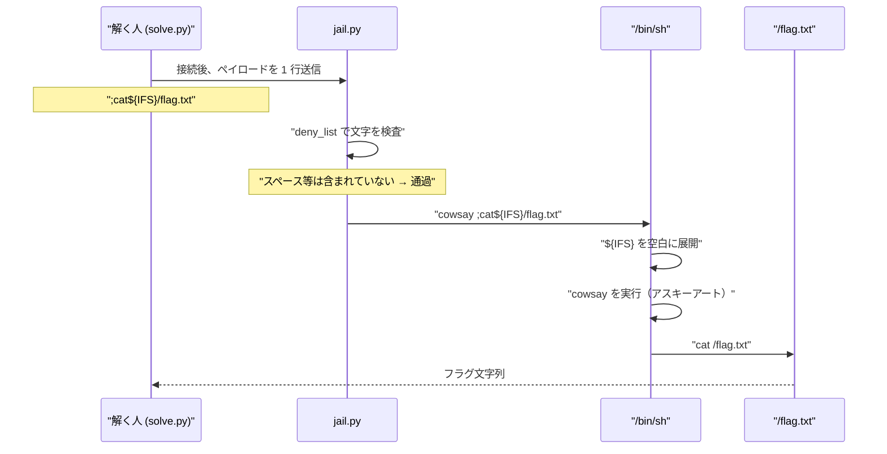

> [!IMPORTANT]
> **Solved with Gemini in Colab**
>
> この問題は Google の AI コーディングアシスタント **Gemini in Colab** を活用して解決されました。

> [!NOTE]
> この Writeup は AI により自動生成されています。 本ドキュメントは、AI アシスタントを用いて作成された Writeup です。記載内容は解法の一例であり、内容の正確性については十分にご確認の上ご利用ください。

# cowsay jail

## 概要
*   **カテゴリー**: Misc
*   **トピック**: Jail
*   **難易度**: Medium 4.0
*   **問題リンク**: [cowsay jail - Daily AlpacaHack](https://alpacahack.com/daily/challenges/cowsay-jail)

## 使用ツール
*   **Python 3**: 解法スクリプトの実装（`socket` / `time` は標準ライブラリのみ）
*   **cowsay**: 問題サーバー側で実行されるコマンド（攻撃者側では不要）
*   **Gemini in Colab**: 配布ファイルの解析およびコード生成

## 問題の分析
本問題は **Daily AlpacaHack** の Jail（コマンド実行制限の突破）問題です。問題文は次のとおりです。

> The `cowsay` command is a great command for emphasizing a text! 🦙  
> flag is at `/flag.txt`.

配布されるのは主に次のファイルです。

| ファイル | 内容 |
| :--- | :--- |
| `jail.py` | 入力をフィルタしたうえで `cowsay` を `shell=True` で実行する本体 |
| `Dockerfile` / `compose.yaml` | チャレンジ環境の定義 |
| `flag.txt` | ローカル用のダミーフラグ（本番では `/flag.txt`） |

`jail.py` の中身は次の通りです（本質部分のみ）。

```python
import subprocess

argument = input("$ cowsay ")

deny_list = ["\t", " ", "-", "'", '"', "`", "(", ")", "<", ">", "&", "|"]
denied_characters = [c for c in deny_list if c in argument]
if len(denied_characters) > 0:
    raise SystemExit(f"The argument contains at least 1 denied character(s): {denied_characters}")

subprocess.run(
    f"cowsay {argument}",
    shell=True,
    stdin=subprocess.DEVNULL,  # no input
)
```

ポイントを表にまとめます。

| 項目 | 内容 |
| :--- | :--- |
| 入力の使い方 | `f"cowsay {argument}"` としてシェルに渡す |
| `shell=True` | シェル経由で実行されるため、`;` などのメタ文字が効く |
| `deny_list` | タブ・スペース・ハイフン・引用符・バッククォート・括弧・リダイレクト・`&`・`\|` を禁止 |
| フラグの場所 | `/flag.txt`（絶対パス。ハイフンを含まない） |

> [!TIP]
> Beginner Hint でも示されている通り、方針は 2 段階です。
>
> 1. `shell=True` を活かして、`cowsay` 以外のコマンドを実行する
> 2. スペースが使えないので、空白を別の表現で書く

接続からフラグ取得までの流れは次のようになります。



## 脆弱性の詳細

### shell=True によるコマンド連結
`subprocess.run(cmd, shell=True)` は、文字列 `cmd` をそのままシェルに渡します。シェルでは `;` が **コマンド区切り** になるので、次のように書くと 2 つのコマンドが順番に実行されます。

```bash
cowsay hello; cat /flag.txt
#  ↑ cowsay のあと   ↑ 別コマンド
```

今回の `jail.py` では `f"cowsay {argument}"` なので、`argument` の先頭に `;` を置けば、`cowsay` のあとに任意のコマンドを続けられます。

### deny_list とスペース問題
ただし `deny_list` にスペースが入っているため、素直な `cat /flag.txt` は弾かれます。

| やりたいこと | 素直な書き方 | deny_list に引っかかる文字 |
| :--- | :--- | :--- |
| コマンド連結 | `;cat /flag.txt` | スペース |
| パイプ | `\| cat` | `\|` |
| リダイレクト | `cat</flag.txt` | `<` |
| コマンド置換 | `` `cat /flag.txt` `` | `` ` `` とスペース |

> [!WARNING]
> 一見便利そうな `;cat</flag.txt`（スペースなしのリダイレクト）は、この問題では **使えません**。`deny_list` に `<` が含まれているためです。スペース回避だけを考えると見落としやすい点です。

### IFS（パラメータ展開）によるスペース回避
Bash / sh には **IFS**（Internal Field Separator）という変数があります。既定値はスペース・タブ・改行を含むので、パラメータ展開 ``${IFS}`` は「空白 1 文字」として使えます。

シェルが `${IFS}` を空白に展開する様子を式で書くと、次のようになります。

$$
\texttt{cat}\mathbin{\$}\texttt{\{IFS\}/flag.txt}
\xrightarrow{\text{expand}}
\texttt{cat /flag.txt}
$$

（左が送信ペイロード、右がシェル展開後に実行される形。）

しかも `$`・`{`・`}`・`/`・文字・`;` はいずれも `deny_list` に入っていません。

したがって最終ペイロードは次です。

```text
;cat${IFS}/flag.txt
```

サーバー側で実際に走るコマンドは次のようになります。

```bash
cowsay ;cat${IFS}/flag.txt
```

1. `cowsay`（引数なし）→ 空の吹き出しのアスキーアート
2. `cat /flag.txt` → フラグ表示

### 補足: なぜパスにハイフンを使わないか
`deny_list` には `-` も含まれます。そのため、例えばカレント相対でハイフン付きの名前を指定する書き方は弾かれます。今回フラグは `/flag.txt` なので、ハイフンを使わずに読めます。

### 補足: 検査は「部分文字列」ではなく「1 文字ずつ」
フィルタは次の形です。

```python
denied_characters = [c for c in deny_list if c in argument]
```

つまり **deny_list の各文字が入力に含まれるか** を見ています。`${IFS}` のような「変数名の文字列」そのものが禁止されているわけではないので、展開後に空白になる表現をそのまま書けます。

## 用語解説

| 用語 | 意味 |
| :--- | :--- |
| **Jail** | 入力や実行環境に制限をかけた状態から抜け出し、本来禁止されている操作（ここでは任意コマンド実行）を行う系統の問題 |
| **`shell=True`** | Python の `subprocess` で、コマンド文字列をシェル経由で実行するオプション。メタ文字が解釈される |
| **`deny_list`** | 入力に含めてはいけない文字の一覧。ここに載っている文字が 1 つでもあれば拒否される |
| **コマンドインジェクション** | 想定外の文字列を差し込み、本来のコマンドのあとに別コマンドを実行させる攻撃 |
| **IFS** | Internal Field Separator。シェルが単語を区切るときに使う文字集合。既定では空白類を含む |
| **`${IFS}`** | IFS の値を展開する書き方。スペースの代わりとして Jail 問題でよく使われる |
| **`cowsay`** | 文字列を牛のアスキーアート付きで表示するコマンド。本問では「入口」として使われているだけ |

## 解決スクリプト
追加ライブラリは不要です。問題ページでインスタンスを起動し、表示されたホストとポートを指定して実行してください。

```bash
python3 solve.py
# または
python3 solve.py <host> <port>
```

スクリプトの流れは次のとおりです。

1. TCP でチャレンジサーバーへ接続する
2. 初期プロンプト（`$ cowsay `）を受信する
3. ペイロード `;cat${IFS}/flag.txt` を送信する
4. cowsay の出力のあとに続くフラグを表示する

本体はリポジトリ直下の [`solve.py`](./solve.py) です。
